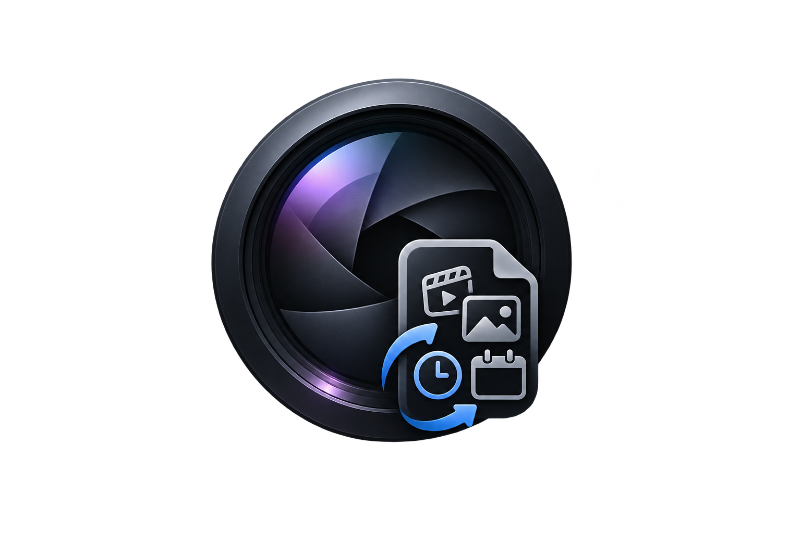
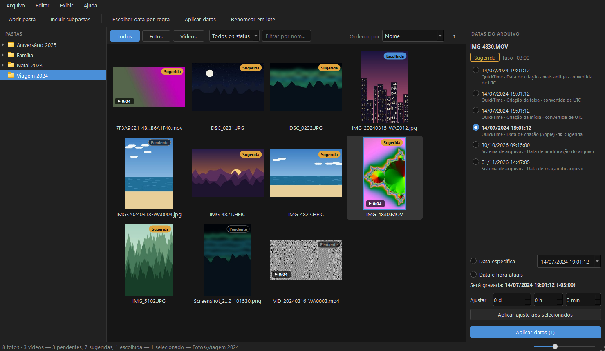
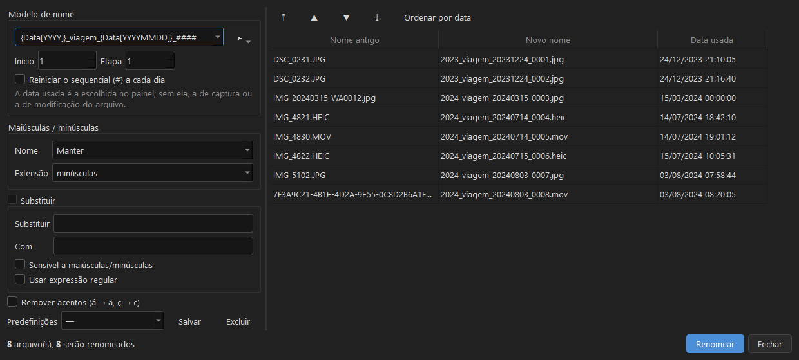

<p align="center">
  
</p>

<h1 align="center">AGS Media Chrono</h1>

<p align="center">
  <b>Todas as datas das suas fotos e vídeos em um só lugar — escolha a certa, grave e renomeie em lote.</b>
</p>

<p align="center">
  <a href="https://github.com/adnerscarpelini/ags-media-chrono/releases/latest"></a>
  <a href="https://github.com/adnerscarpelini/ags-media-chrono/actions/workflows/ci.yml"></a>
  
  <a href="LICENSE"></a>
</p>

<p align="center">
  <a href="https://github.com/adnerscarpelini/ags-media-chrono/releases/latest"><b>⬇ Baixar a última versão</b></a> ·
  <a href="#como-usar">Como usar</a> ·
  <a href="CHANGELOG.md">Novidades</a>
</p>

Aplicativo desktop (Windows e Linux) para organizar fotos e vídeos: mostra todas as datas
encontradas em cada arquivo (EXIF, XMP, QuickTime, sistema de arquivos, nome do arquivo),
permite escolher a data correta, gravá-la em todos os campos e renomear em lote com máscaras.

Feito para corrigir mídias baixadas do iCloud, recebidas pelo WhatsApp ou vindas de câmeras
(ex.: Nikon), onde a data correta fica em lugares diferentes.

<p align="center">
  
</p>

<p align="center">
  
</p>

## Instalação

Baixe o pacote da sua plataforma na página de
[Releases](https://github.com/adnerscarpelini/ags-media-chrono/releases) — não é preciso ter
Python instalado; ExifTool e FFmpeg já vêm dentro:

- **Windows:** extraia o `.zip` e abra `ags-media-chrono.exe`.
- **Linux:** `chmod +x ags-media-chrono-*.AppImage` e execute; ou extraia o `.tar.gz` e rode
  `ags-media-chrono/ags-media-chrono`.

## Como usar

1. **Abra uma pasta** pela árvore à esquerda ou em *Arquivo › Abrir pasta* (`Ctrl+O`).
   Marque *Incluir subpastas* se quiser.
2. **Revise as datas.** Cada miniatura ganha um selo:
   - **Sugerida** — o arquivo já tem data de captura (EXIF, QuickTime…), e ela foi pré-selecionada;
   - **Pendente** — não há data de captura; escolha uma;
   - **Escolhida**, **Aplicado** ou **Erro**.

   Clique em um arquivo para ver **todas as datas encontradas** no painel da direita, já no
   horário local (datas de vídeo gravadas em UTC são convertidas). Escolha uma delas, uma
   **data específica** ou a **data atual**. Use **Ajustar** para somar/subtrair dias, horas e
   minutos (câmera com relógio errado).
3. **Escolha em lote** (`Ctrl+R`): defina a prioridade — por exemplo *data de captura → data
   no nome do arquivo → mais antiga* — e aplique a muitos arquivos de uma vez.
4. **Aplique** (`Ctrl+Enter`): a data é gravada nos metadados (EXIF/XMP das fotos,
   QuickTime/Keys dos vídeos) e nas datas do arquivo. Há opção de guardar cópia dos originais.
5. **Renomeie em lote** (`F2`) com máscaras, por exemplo
   `{Data[YYYY]}_aniversario_{Data[YYYYMMDD]}_####` → `2026_aniversario_20261101_0001.jpg`.
   Ou faça os dois de uma vez: *Editar › Aplicar datas e renomear…*.
6. **Errou?** *Editar › Desfazer última aplicação* (`Ctrl+Z`) ou *Histórico de alterações*
   (`Ctrl+H`) desfaz gravações de datas e renomeações.

### Máscaras de nome

| Máscara | Resultado |
|---|---|
| `{Data}` | `2026-11-01` |
| `{Data[YYYY]}` `{Data[YY]}` `{Data[MM]}` `{Data[DD]}` | ano, ano com 2 dígitos, mês, dia |
| `{Data[HH]}` `{Data[mm]}` `{Data[ss]}` | hora, minuto, segundo |
| `{Data[YYYYMMDD_HHmmss]}` | qualquer combinação dos códigos acima |
| `{Nome}` · `{Ext}` · `{Pasta}` · `{Tipo}` | nome original, extensão, pasta, `foto`/`video` |
| `#`, `##`, `####` | sequencial com zeros à esquerda (início, etapa e reinício por dia configuráveis) |

A data usada é a escolhida no painel; sem escolha, a de captura; sem ela, a de modificação.

### Atalhos

| Ação | Atalho |
|---|---|
| Abrir pasta | `Ctrl+O` |
| Zoom das miniaturas | `Ctrl` + roda do mouse, `Ctrl+=` / `Ctrl+-` / `Ctrl+0` |
| Todos / só fotos / só vídeos | `Ctrl+1` / `Ctrl+2` / `Ctrl+3` |
| Selecionar tudo / limpar seleção | `Ctrl+A` / `Ctrl+Shift+A` |
| Ver ampliado | duplo clique ou `Enter` (no visualizador: `←` `→`, `Espaço`, `F11`, `Esc`) |
| Escolher data por regra | `Ctrl+R` |
| Aplicar datas / aplicar e renomear | `Ctrl+Enter` / `Ctrl+Shift+Enter` |
| Renomear em lote | `F2` |
| Desfazer / histórico | `Ctrl+Z` / `Ctrl+H` |

### Onde ficam os dados

| O quê | Windows | Linux |
|---|---|---|
| Configurações | `%APPDATA%\AGS\ags-media-chrono.ini` | `~/.config/AGS/ags-media-chrono.ini` |
| Cache de miniaturas | `%LOCALAPPDATA%\ags-media-chrono\miniaturas` | `~/.cache/ags-media-chrono/miniaturas` |
| Histórico (desfazer) | `%LOCALAPPDATA%\ags-media-chrono\historico` | `~/.local/share/ags-media-chrono/historico` |
| Cópias dos originais (opcional) | `_backup_ags-media-chrono` dentro da pasta das fotos | idem |

### Limitações conhecidas

- **Linux:** a maioria dos sistemas de arquivos não permite alterar a *data de criação* do
  arquivo; os metadados e a data de modificação são alterados normalmente.
- **BMP, AVI, MKV, WMV, WEBM, MTS:** o formato não aceita gravação de metadados de data; só as
  datas do arquivo são alteradas (o relatório avisa).
- A data no nome do arquivo (ex.: WhatsApp `IMG-20230512-WA0001.jpg`) é oferecida como opção,
  mas não é pré-selecionada — use a escolha por regra para aplicá-la em lote.

## Documentação

- [Novidades (CHANGELOG)](CHANGELOG.md)
- [Requisitos](docs/REQUISITOS.md)
- [Tarefas / roadmap](docs/TAREFAS.md)
- [Como publicar uma versão](docs/RELEASE.md)

## Tecnologias

Python 3.13 · PySide6 (Qt 6) · ExifTool · FFmpeg · PyInstaller

## Ambiente de desenvolvimento

Requer Python 3.11+ (recomendado 3.13).

```bash
python -m venv .venv
# Windows
.venv\Scripts\activate
# Linux
source .venv/bin/activate

pip install -e ".[dev]"
python tools/baixar_ferramentas.py   # ExifTool e FFmpeg em tools/bin/
```

O app procura ExifTool/FFmpeg nesta ordem: variáveis `AGS_EXIFTOOL` / `AGS_FFMPEG`,
`tools/bin/` e o PATH do sistema. No Linux, em vez do script, também dá para
usar os pacotes do sistema (`sudo apt install libimage-exiftool-perl ffmpeg`). A versão Linux
do ExifTool é um script Perl, então o `perl` precisa estar instalado.

Comandos:

```bash
python -m ags_media_chrono   # abre o app
pytest                       # testes
ruff check . && ruff format --check .   # lint
```

Para testar também com um RAW real da Nikon (não versionado), defina `AGS_AMOSTRA_NEF` com o
caminho de um `.NEF` antes de rodar o `pytest`.

Para gerar o pacote distribuível da plataforma atual (Windows: `.zip`; Linux: `.tar.gz` e
AppImage) em `dist/`:

```bash
python tools/empacotar.py
```

O script baixa ExifTool/FFmpeg se faltarem, roda o PyInstaller e testa o executável gerado
(`ags-media-chrono --verificar relatorio.txt`).

Pasta de demonstração e prints do README (imagens sintéticas, sem fotos pessoais):

```bash
python tools/criar_demo.py "C:\Temp\Viagem 2024"   # só a pasta, para testar o app
python tools/capturar_telas.py                         # recria assets/captura-*.png
```

No Linux, o Qt pode precisar de bibliotecas do sistema (ex.: Ubuntu:
`sudo apt install libxcb-cursor0 libegl1`).

## Contribuição

A branch `main` é protegida. Toda alteração entra por Pull Request vinculado a uma Issue.
